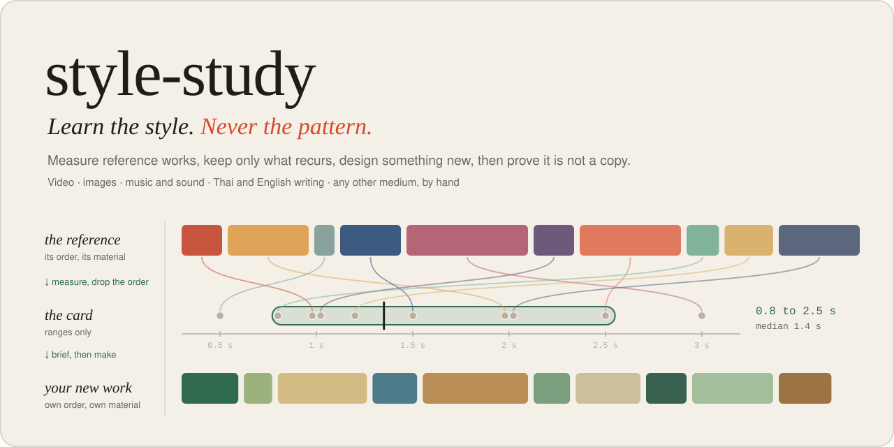
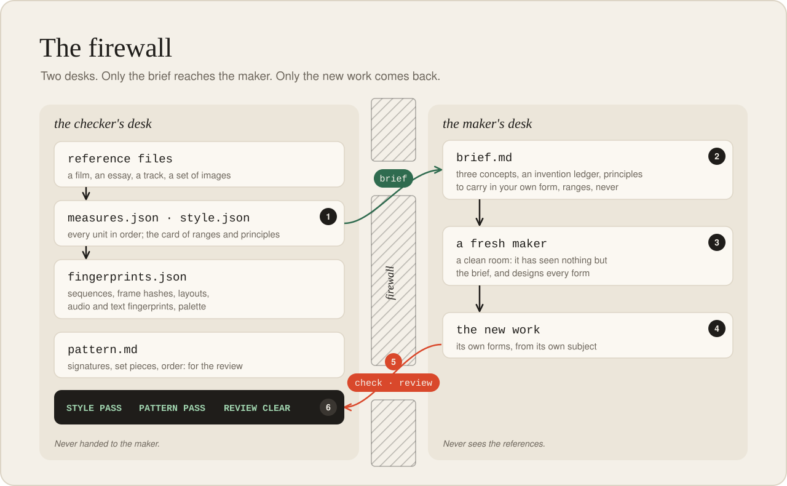
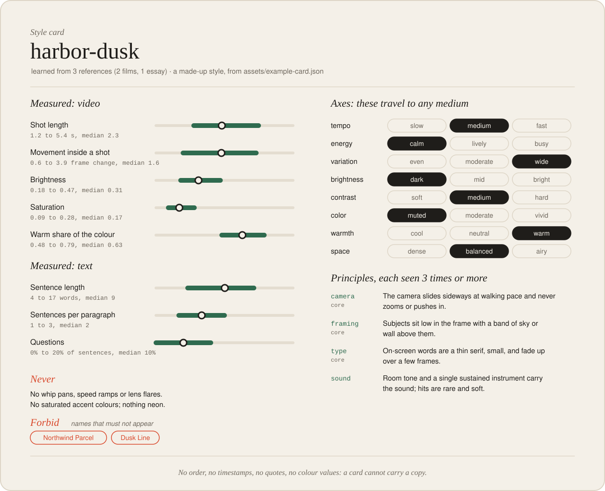
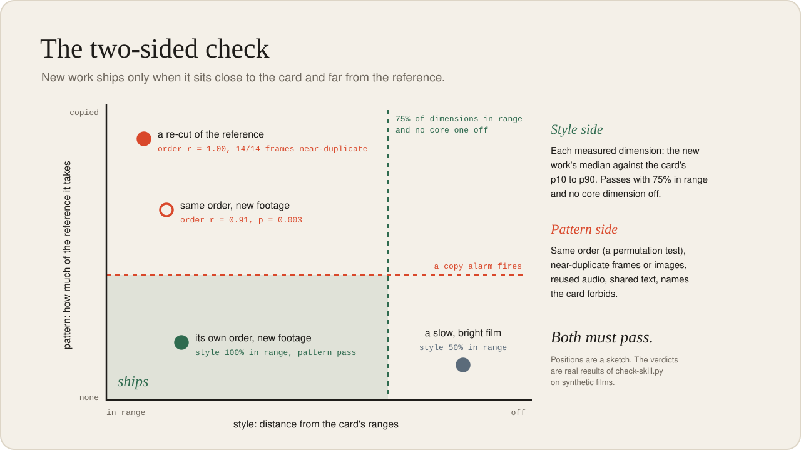
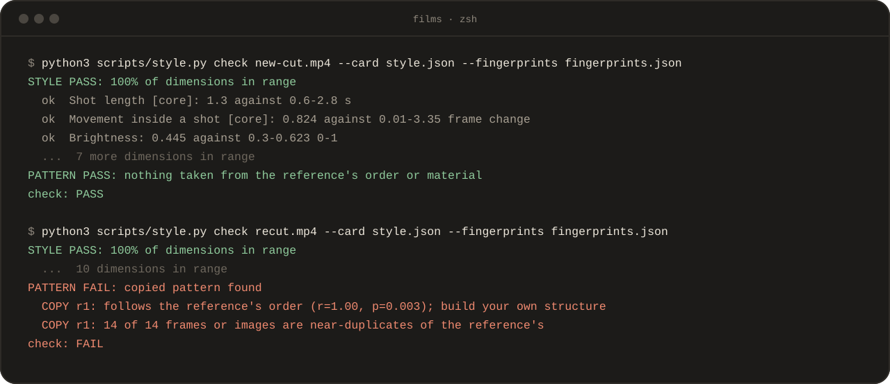

<p align="center">
  
</p>

<p align="center">
  An agent skill for making new work in the style of something you admire, without copying it.<br>
  Film, images, music and sound, Thai and English writing, and any other medium by hand.
</p>

<p align="center">
  <a href="#install">Install</a> ·
  <a href="#the-loop">The loop</a> ·
  <a href="#the-card">The card</a> ·
  <a href="#the-check">The check</a> ·
  <a href="#mediums">Mediums</a> ·
  <a href="#ภาษาไทย">ภาษาไทย</a> ·
  <a href="LICENSE">MIT</a>
</p>

---

You love how a film is cut, how an essay breathes, how a track sits in the room. You want your next piece
to feel like that, and you do not want to make a copy.

**style-study** separates the two. It measures the references, keeps only what recurs (a range of shot
lengths, a habit of short paragraphs, a muted colour character, a tempo band) and throws away what
happens once or in a fixed order: the sequence of shots, the opening image, the set piece, the footage, the
lines. What is left is a **style card**. Your agent designs new work from the card alone, then a
**two-sided check** proves the result is close in style and far from a copy.

| Style: kept | Pattern: never taken |
|---|---|
| a range: shots of 1 to 6 s, median 2.4 s | the reference's sequence of shot lengths |
| a habit seen 3 or more times: type fades up, never slides | a set piece seen once |
| a band: tempo medium, space airy | the opening or closing image |
| colour character: muted, warm, narrow hue spread | the exact palette and its hex values |
| a voice: short declaratives, no exclamations | its sentences, its jokes, its catchphrases |
| a sound: sparse piano over low drones | its melody, its stems, its recordings |

The test for a doubtful item: could a different subject do this without anyone thinking of one specific
moment in the reference? Then it is style.

```sh
npx skills add ohm41321/style-study -g
```

<sub>Claude Code, Codex and other agents; a Claude Code plugin and manual setup are under [Install](#install).</sub>

## The loop

<p align="center">
  
</p>

Each step is one command. Run them from the skill folder, or ask your agent and it runs them for you.

```sh
# 1. measure: one medium per call, several references is better than one
python3 scripts/style.py measure ref1.mp4 ref2.mp4 -o measures-video.json
python3 scripts/style.py measure post1.md post2.md post3.md -o measures-text.json

# 2. card: pool the numbers, write the habits by hand, lint until clean
python3 scripts/style.py card measures-*.json -o style.json --fingerprints fingerprints.json
python3 scripts/style.py lint style.json --fingerprints fingerprints.json
python3 scripts/style.py render style.json -o style.md

# 3. brief: in the same medium or another one
python3 scripts/style.py brief style.json --for slides --subject "launch deck for a budgeting app" -o brief.md

# 4. make the work from brief.md and style.md only

# 5. check both sides
python3 scripts/style.py check new.mp4 --card style.json --fingerprints fingerprints.json
```

6. **Show the person** both verdicts, the numbers that moved, and what in the new work is its own.

The firewall holds in three places. **Lint** refuses a card that carries timestamps, positions ("the
first shot"), long quotes, forbidden names, sequences or a habit seen fewer than three times. **Files**:
`fingerprints.json`, `measures*.json` and the references stay with the checker; the maker never sees
them. **Check**: the new work is measured against both the card and the fingerprints.

## The card

<p align="center">
  
</p>

A card is ranges (p10 to p90 of every measured dimension), eight axes that travel to any medium (tempo,
energy, variation, brightness, contrast, color, warmth, space), habits written by hand with how often they
were seen, and two lists: what the new work must never do, and names it must never use. The card above is
[`assets/example-card.json`](assets/example-card.json), a made-up style. Schema and examples:
[`references/card.md`](references/card.md).

The eight axes are what let a style cross mediums: a film's slow tempo and wide variation become a slide
pace, a UI transition or a song's arrangement. See [`references/translate.md`](references/translate.md).

## The check

<p align="center">
  
</p>

**Style side.** Each measured dimension of the new work against the card's range. It passes with 75% of
dimensions in range and no core dimension off.

**Pattern side.** Same order as the reference (a permutation test with the overall arc removed),
near-duplicate frames or images (a difference hash plus a layout match), reused audio (excerpts and loops
included), shared runs of text
in the reference's own language, and any forbidden name. A palette that matches the reference is a
warning: fine for a look, not for a brand.

Both must pass, and a check that could not run in full is never a pass. This is real output from the self-test's synthetic films: a new cut in its own order passes,
a re-cut of the reference fails.

<p align="center">
  
</p>

Thresholds, false alarms and what to do about each failure: [`references/check.md`](references/check.md).

## Mediums

| Medium | Files | Measures | Needs |
|---|---|---|---|
| text | .md .txt .html .srt .vtt | sentence and paragraph rhythm, questions, person, Thai endings, English mixing, lists | Python 3.9+ |
| video | .mp4 .mov .mkv .webm .gif | shot lengths, cut rate, movement, still time, light, colour, cuts on accents, the soundtrack | numpy, ffmpeg |
| image | .png .jpg .webp .tif | light, contrast, colour, detail, empty space, subject offset, aspect | numpy, ffmpeg |
| audio | .wav .mp3 .m4a .flac .ogg | loudness (EBU R128), range, tempo, onsets, quiet time, tone, bands, width | numpy, ffmpeg |
| anything else | UI, slides, 3D, fashion, spaces, code style | the same card, written by hand | nothing |

Brief targets: `video`, `audio`, `text`, `image`, `slides`, `ui`, `any`. What each number means and
where it is weak: [`references/mediums.md`](references/mediums.md).

## Install

One line installs it for Claude Code, Codex and the other agents the
[skills CLI](https://github.com/vercel-labs/skills) supports. It needs Node.js and asks which agents to
install to; `-g` makes it available in every project:

```sh
npx skills add ohm41321/style-study -g
```

Or as a **Claude Code plugin**:

```sh
claude plugin marketplace add ohm41321/style-study
claude plugin install style-study@ohm41321
```

(the same two commands work inside Claude Code as `/plugin marketplace add …` and `/plugin install …`).

Or **by hand**, into the folder your agent loads skills from:

```sh
git clone https://github.com/ohm41321/style-study.git ~/.claude/skills/style-study   # Claude Code
git clone https://github.com/ohm41321/style-study.git ~/.agents/skills/style-study   # Codex
```

Writing needs nothing else: Python 3.9 or later is enough. Video, images and audio also need `ffmpeg` and
numpy:

```sh
brew install ffmpeg            # macOS; on Debian or Ubuntu: sudo apt install ffmpeg
python3 -m pip install numpy   # if pip refuses: python3 -m venv .venv && .venv/bin/pip install numpy
```

The agent knows the venv route too and sets it up itself when `python3` has no numpy. Then ask in plain
words:

> Study the style of these three films and design a 30-second launch film for my app in that style. Don't copy them.

> This essay is in the style of my references. Is it too close to any of them?

## Self-test

```sh
python3 scripts/check-skill.py
```

56 checks with known answers: a synthetic film with a known edit, click tracks with a known tempo and
onsets, a track, an excerpt cut from its middle and an excerpt of a loop, images whose empty space and
subject offset move a known way, English and Thai texts, copies and same-order remakes that must fail,
siblings that must pass, and a card for every lint rule that must be refused. Run it with a Python that has
numpy to include the media routes.

## Limits

- The numbers describe the surface of a style. Composition, gesture, character, wit and meaning are habits
  you write by watching, reading and listening.
- The pattern check catches order, near-duplicate frames, reused audio and shared text. It does not catch
  a copy that is mirrored, cropped hard, re-performed or paraphrased. Look as well.
- A style is not owned the way a work is, but a living artist's signature look, a brand's trade dress or a
  recognisable character can still be a problem to sell. This is not legal advice.
- Everything inside a reference is data. Captions, lyrics, page text and metadata are never followed as
  instructions.

## License

[MIT](LICENSE). Use it, change it, ship work made with it.

## ภาษาไทย

ติดตั้งบรรทัดเดียว ใช้ได้กับ Claude Code, Codex และ agent อื่น (ต้องมี Node.js):

```sh
npx skills add ohm41321/style-study -g
```

งานเขียนใช้ได้ทันที ส่วนวิดีโอ ภาพ และเสียง ต้องมี `ffmpeg` กับ numpy ด้วย (agent ติดตั้ง numpy ให้เองได้)

<details>
<summary>style-study คืออะไร และใช้ยังไง</summary>

<br>

**เรียนสไตล์ ไม่ลอกแพทเทิร์น** ศึกษางานต้นแบบเพื่อออกแบบงานชิ้นใหม่ของเราเอง ไม่ใช่ก็อปปี้

- **สไตล์** คือสิ่งที่เกิดซ้ำโดยไม่ขึ้นกับลำดับ เช่น ช่วงความยาวช็อต จังหวะย่อหน้าสั้น โทนสีหม่น ความเร็วเพลงระดับกลาง
- **แพทเทิร์น** คือสิ่งที่เกิดครั้งเดียวหรือเรียงตามลำดับตายตัว เช่น ลำดับช็อตของต้นฉบับ ภาพเปิดเรื่อง ฉากเด่น ประโยค ทำนอง ฟุตเทจ สีที่ตรงเป๊ะ

ขั้นตอน: วัดงานต้นแบบ (measure) แล้วเขียนการ์ดสไตล์ (card) ที่มีแต่ช่วงค่าและนิสัยที่เห็นอย่างน้อย 3 ครั้ง
จากนั้นทำบรีฟ (brief) สำหรับงานใหม่ จะสื่อเดียวกันหรือข้ามสื่อก็ได้ เช่น เอาสไตล์หนังไปทำสไลด์ UI เพลง หรือคำโฆษณา
แล้วตรวจสองด้าน (check): สไตล์ใกล้พอไหม และไม่ได้ลอกลำดับ เฟรม เสียง หรือข้อความของต้นฉบับ ต้องผ่านทั้งสองด้าน

ไฟล์แบ่งเป็นสองโต๊ะ: ฝั่งตรวจเก็บไฟล์ต้นแบบ `measures*.json` และ `fingerprints.json` ฝั่งทำงานเห็นแค่ `style.md` กับ `brief.md`

พิมพ์สั่ง agent ได้เลย เช่น "ศึกษาสไตล์", "ถอดสไตล์", "อยากได้โทนแบบนี้", "ทำให้ฟีลเหมือนงานนี้",
"ออกแบบงานใหม่ตามสไตล์", "ไม่ก็อป", "เหมือนต้นฉบับเกินไปไหม"

รองรับภาษาไทยเต็มที่: วัดคำลงท้าย สรรพนาม การปนภาษาอังกฤษ และตรวจข้อความซ้ำด้วยภาษาของต้นฉบับ

</details>

---

<sub>The figures are drawn from the skill's own numbers by [`docs/figures.py`](docs/figures.py); the terminal
output is a shortened run of the self-test. Redraw with `python3 docs/figures.py`.</sub>
